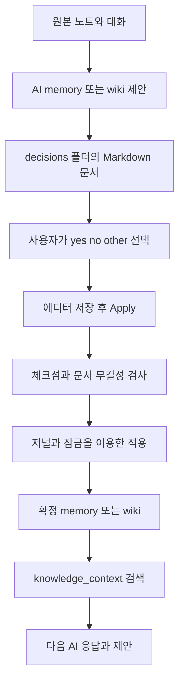

# Kuku 구조와 세컨드 브레인 구현 분석

Kuku에서 가져올 핵심은 로컬 Markdown을 원본으로 유지하면서, AI가 제안한 지식을 사용자의 판단을 거쳐 확정하고 다시 검색하는 구조다. ClineBrain은 이 지식 순환과 Tauri의 파일 처리 기반을 먼저 구현하는 편이 좋다. 3D 그래프, 동기화 서버, 회의 녹음까지 한꺼번에 가져오면 핵심 흐름보다 주변 기능에 개발 비용이 집중된다.

분석 기준은 2026년 10월 19일 조회한 커밋 `c690bb6e952472c788acb7e3ae948c84b03f2268`이다. 아래 코드 링크는 해당 커밋으로 고정했다. 핵심 실행 경로와 관련 테스트를 정적으로 읽은 결과이며, 앱 실행·전체 빌드·테스트 통과를 확인한 보고서는 아니다. 현재 ClineBrain 작업 폴더는 비어 있어 기존 구현과의 통합 제약은 없었다.

함께 읽을 문서: [Tauri 분석](./kuku-tauri.md), [ClineBrain 구현 설계](./clinebrain-blueprint.md).

## 전체 저장소의 역할

| 경로 | 구현과 책임 | ClineBrain에서의 우선순위 |
| --- | --- | --- |
| `apps/desktop` | SolidJS, TypeScript, Vite, Tauri 2 데스크톱 앱 | 핵심 |
| `apps/desktop/src-tauri` | Rust 파일 시스템, 검색, Knowledge, 인증, 동기화, OS 연동 | 핵심 기능만 선별 |
| `crates/kuku-ai` | Tauri AI 플러그인, 세션, provider, tool 실행, 변경 승인 | 핵심 참고 |
| `crates/kuku-indexer` | Markdown 추출, 정규화, 청킹, snippet, wikilink | 핵심 참고 |
| `crates/kuku-contract` | Rust RPC 계약 바인딩 | 서버 도입 시 |
| `apps/server` | Go, Connect RPC, Postgres API; 인증·AI·sync 등 | 초기 로컬 MVP 이후 |
| `apps/web` | Astro 사이트, 인증, dashboard, 배포 정보 | 초기 로컬 MVP 이후 |
| `packages/contract` | 공유 protobuf 계약 | 서버 도입 시 |
| `infra/docker` | 로컬 및 운영 서버 구성 | 서버 도입 시 |

JS 워크스페이스는 pnpm과 moon, Rust는 Cargo workspace로 구성한다. 에디터 계열은 ProseKit/ProseMirror, 코드 편집에는 CodeMirror, 그래프에는 Three.js 및 관련 라이브러리가 들어간다. 웹사이트와 데스크톱 UI는 별도 앱이다. [개발 구조](https://github.com/kuku-mom/kuku/blob/c690bb6e952472c788acb7e3ae948c84b03f2268/docs/development.md), [데스크톱 의존성](https://github.com/kuku-mom/kuku/blob/c690bb6e952472c788acb7e3ae948c84b03f2268/apps/desktop/package.json)

## 세컨드 브레인의 실제 디스크 구조

초기화 코드가 만드는 경로는 다음과 같다.

```text
Vault/
├── 사용자의 일반 Markdown 노트
├── Knowledge/
│   ├── memory/
│   ├── proposals/
│   ├── decisions/
│   └── wiki/
│       ├── sources/
│       ├── concepts/
│       ├── entities/
│       └── synthesis/
└── .kuku/knowledge/
    ├── apply-journal/
    ├── apply-tmp/
    ├── apply-lock/
    └── document-write-lock/
```

`Knowledge/proposals`가 존재한다고 해서 제안 파일이 그곳에 생성되는 것은 아니다. 현재 memory/wiki 제안 생성 경로는 **`Knowledge/decisions/`에 제안 블록과 판단 블록을 포함한 문서 하나를 생성**한다. 관련 테스트도 이때 확정 memory/wiki 파일이 생성되지 않는 것을 검사한다. 폴더 이름만 보고 `proposals → decisions` 파일 이동 파이프라인으로 구현하면 원본과 달라진다. [초기화](https://github.com/kuku-mom/kuku/blob/c690bb6e952472c788acb7e3ae948c84b03f2268/apps/desktop/src-tauri/src/knowledge/service.rs), [제안 생성과 테스트](https://github.com/kuku-mom/kuku/blob/c690bb6e952472c788acb7e3ae948c84b03f2268/apps/desktop/src-tauri/src/knowledge/proposal.rs)

## 데이터 모델

| 모델 | 주요 필드 | 의미 |
| --- | --- | --- |
| MemoryItem | id, kind, title, status, tags, source_refs, created_at, updated_at, proposal_id, decision_document, body | 재사용할 기억 단위 |
| WikiPage | id, page_type, title, status, tags, source_refs, timestamps, proposal_id, decision_document, body | 설명과 연결을 담는 지식 페이지 |
| SourceRef | path, title, section_path, range, checksum, captured_at | 어떤 원본을 근거로 만들었는지 |
| Decision | yes / no / other, other_text, 대상 change ID | 제안별 사용자 판단 |

Memory의 `kind`는 문자열이며 tool 설명은 decision, preference, fact를 예로 든다. 고정 enum으로 제한하지 않는다. Wiki의 `page_type`은 `source`, `concept`, `entity`, `synthesis` enum이다. Memory와 Wiki의 상태는 모두 `active`, `archived`, `superseded`다. 본문은 YAML frontmatter 밖에 Markdown으로 저장한다. [모델 정의](https://github.com/kuku-mom/kuku/blob/c690bb6e952472c788acb7e3ae948c84b03f2268/apps/desktop/src-tauri/src/knowledge/models.rs), [직렬화와 검증](https://github.com/kuku-mom/kuku/blob/c690bb6e952472c788acb7e3ae948c84b03f2268/apps/desktop/src-tauri/src/knowledge/markdown.rs)

구현 시 해석 예시는 다음과 같다. 이것은 Kuku에 기본 제공되는 콘텐츠가 아니다.

- 원본: 회의록의 “MVP 인증에는 세션 쿠키를 쓰자”라는 발언.
- memory: “이 프로젝트는 MVP 인증에 세션 쿠키를 사용한다”라는 확정 결정.
- wiki/concepts: 세션 인증의 동작과 제약을 설명하는 페이지.
- wiki/synthesis: 이 프로젝트에 세션 인증을 선택한 이유를 여러 원본에서 종합한 페이지.
- decision document: 어떤 제안을 채택했는지, 거절했는지, 수정이 필요한지 남기는 기록.

## 제안에서 확정까지



1. `memory_propose`, `wiki_propose_page`, `wiki_propose_update`가 입력을 검증한다.
2. Markdown frontmatter에 문서 및 proposal ID, target_kind, status, 시각, source_refs를 기록한다.
3. `kuku-memory-proposal` 또는 `kuku-wiki-proposal` 코드 블록에 제안 데이터를 넣는다.
4. 별도의 `kuku-decision` 코드 블록에 판단 항목을 넣는다. 프런트엔드에서는 이 블록을 에디터 노드로 표시한다.
5. 사용자는 문서 안에서 선택을 수정하고 Apply를 실행한다.
6. UI가 먼저 현재 문서를 저장하고, 저장된 텍스트의 SHA-256을 계산해 Rust에 보낸다.
7. Rust가 최신 디스크 내용, pending 상태, 제안과 판단의 연결 무결성을 검사하고 적용한다.

기본 선택값은 `yes`다. 이는 자동 확정이라는 뜻이 아니다. 실제 적용은 별도의 사용자 Apply 경로다. ClineBrain에서는 검토 누락을 줄이려면 기본값 `none`을 고려할 수 있다. [제안 구현](https://github.com/kuku-mom/kuku/blob/c690bb6e952472c788acb7e3ae948c84b03f2268/apps/desktop/src-tauri/src/knowledge/proposal.rs), [에디터 적용](https://github.com/kuku-mom/kuku/blob/c690bb6e952472c788acb7e3ae948c84b03f2268/apps/desktop/src/plugins/builtin/knowledge/editor_apply.ts)

### 상태 해석에서 주의할 부분

| 선택 조합 | 문서 결과 상태 | 확정 파일 |
| --- | --- | --- |
| yes만 또는 yes와 no | applied | yes 항목만 반영 |
| no만 | applied | 생성 없음 |
| other 포함, yes 없음 | needs_revision | 생성 없음 |
| yes와 other 포함 | partially_applied | yes 항목만 반영 |

`applied`는 모든 제안이 채택되었다는 의미가 아니라 판단 처리가 끝났다는 의미다. `other`는 실제 적용 단계에서 비어 있지 않은 의견을 요구한다. 미선택 판단은 검증 실패다. 기존 wiki 수정은 대상 파일의 `expected_checksum`을 요구한다. 현재 문서는 target_kind가 memory 또는 wiki 중 하나이며, 하나의 결정 문서가 양쪽을 동시에 처리하는 일반 변경 묶음은 아니다. [적용 상태 계산](https://github.com/kuku-mom/kuku/blob/c690bb6e952472c788acb7e3ae948c84b03f2268/apps/desktop/src-tauri/src/knowledge/apply.rs)

### 장애 복구 구조

Apply는 문서 ID 잠금과 문서 쓰기 잠금을 잡고 디스크 내용을 다시 읽는다. 저널 상태는 `staged`, `finalized`, `document_saved`, `cleanup_required`다. staging, 파일 반영, 결정 문서 저장, 정리 중 어디까지 진행했는지를 남긴다. 복구 시 경로와 체크섬이 계획과 일치하는지 검증하며, 다른 내용으로 변경된 파일을 무조건 되돌리지 않는다.

이는 여러 파일을 다루는 복구 프로토콜이다. 파일 시스템 전체가 데이터베이스의 단일 ACID 트랜잭션처럼 동작한다고 해석하면 안 된다. 특히 기존 wiki 수정, 중간 종료, 외부 편집의 조합을 제품 테스트로 검증해야 한다. [apply 및 recovery 구현](https://github.com/kuku-mom/kuku/blob/c690bb6e952472c788acb7e3ae948c84b03f2268/apps/desktop/src-tauri/src/knowledge/apply.rs)

## AI가 지식에 접근하는 방식

등록된 Knowledge AI 도구는 8개다.

| 읽기 계열 | 제안 계열 |
| --- | --- |
| memory_search | memory_propose |
| memory_context | wiki_propose_page |
| wiki_search | wiki_propose_update |
| wiki_read | |
| knowledge_context | |

`memory_commit`, `memory_write`, `memory_delete`, `knowledge_apply_decision_document`, `wiki_write_page`, `wiki_commit`, `wiki_apply_decision_document`는 금지 도구 이름으로 명시되어 있다. 일반 AI 파일 변경 도구도 `Knowledge/memory`, `Knowledge/decisions`, `Knowledge/wiki`를 직접 수정하지 못하게 경로 보호를 호출한다. 경로 보호에는 percent decoding, Unicode 정규화, 대소문자, symlink 해석이 포함된다. [AI 도구](https://github.com/kuku-mom/kuku/blob/c690bb6e952472c788acb7e3ae948c84b03f2268/apps/desktop/src/plugins/builtin/knowledge/ai_tools.ts), [보호 경로](https://github.com/kuku-mom/kuku/blob/c690bb6e952472c788acb7e3ae948c84b03f2268/apps/desktop/src-tauri/src/knowledge/protected_paths.rs), [파일 도구의 guard 사용](https://github.com/kuku-mom/kuku/blob/c690bb6e952472c788acb7e3ae948c84b03f2268/apps/desktop/src-tauri/src/ai_tools/file_tools.rs)

다만 이 보호는 **AI 도구 정책**이다. 사용자의 로컬 파일 소유권을 없애는 OS 접근 통제가 아니고, 동일 WebView에서 실행되는 모든 코드에 대한 독립적인 보안 경계라고도 볼 수 없다. Apply 요청의 `source: editor_document_apply` 문자열 역시 호출 의도를 나타내며 암호학적인 승인 증명은 아니다.

AI runtime에는 Ask, Agent, Inline 모드가 있고, provider 구현은 Gemini 및 remote로 분리되어 있다. 세션에서 active file, 열린 탭의 경로, 선택 텍스트, 첨부 파일을 context로 구성한다. 확인한 system prompt와 turn context 경로에는 매 요청마다 전체 memory를 자동으로 주입하는 동작이 없다. Knowledge 도구를 통해 필요한 정보를 조회하는 구조로 이해하는 것이 정확하다. “self-improving”은 모델 학습보다 **외부 지식의 명시적 축적과 재사용**에 가깝다. [프롬프트](https://github.com/kuku-mom/kuku/blob/c690bb6e952472c788acb7e3ae948c84b03f2268/crates/kuku-ai/src/prompts.rs), [세션](https://github.com/kuku-mom/kuku/blob/c690bb6e952472c788acb7e3ae948c84b03f2268/crates/kuku-ai/src/session.rs)

## 검색과 그래프는 구분해서 봐야 한다

| 항목 | 일반 Vault 검색 | Knowledge 검색 |
| --- | --- | --- |
| 저장 접근 | SQLite 파생 인덱스 | Markdown 파일 수집 및 직접 파싱 |
| 주요 구조 | documents, chunk_rows, chunks_fts, wikilink_refs | MemoryItem, WikiPage |
| 매칭 | FTS5와 별도 query planning | 정규화한 전체 query의 substring 검사 |
| 링크 | wikilink 해석과 graph 데이터 | source_refs 및 문서의 링크 |
| 임베딩 검색 | 이 조사 경로에서 확인되지 않음 | 해당 구현에는 없음 |

일반 검색은 SQLite FTS5 `unicode61` tokenizer와 prefix 설정을 사용한다. query planner에는 한 글자, CJK 두 글자 이상, 라틴 문자 길이에 따른 검색 경로 차이가 있다. 따라서 “한국어 지원”을 tokenizer 이름만 보고 판단하지 말고 실제 문장 질의로 평가해야 한다. [SQLite 스키마](https://github.com/kuku-mom/kuku/blob/c690bb6e952472c788acb7e3ae948c84b03f2268/apps/desktop/src-tauri/src/search/db.rs), [query planner](https://github.com/kuku-mom/kuku/blob/c690bb6e952472c788acb7e3ae948c84b03f2268/crates/kuku-indexer/src/plan.rs)

Knowledge 검색은 NFC 및 소문자 정규화 후 제목 100, 태그 75, kind/page_type 50, 본문 25 중 **가장 높은 값 하나**를 점수로 사용한다. 합산 점수나 BM25가 아니다. 기본 limit 10, 최대 50, snippet 최대 240자다. `knowledge_context`는 memory와 wiki 각각에 limit을 적용하므로 통합 결과가 limit 하나로 제한되는 것도 아니다. `active_path`는 유효성을 확인하고 반환하지만 해당 함수에서는 관련성 가중치에 쓰지 않는다. [Knowledge 검색](https://github.com/kuku-mom/kuku/blob/c690bb6e952472c788acb7e3ae948c84b03f2268/apps/desktop/src-tauri/src/knowledge/search.rs)

소스상 보완해야 할 점은 세 가지다.

1. 긴 자연어 질문 전체가 연속 부분 문자열로 들어 있어야 매칭될 수 있어 질문형 retrieval에 불리하다.
2. 매 요청마다 파일을 읽고 파싱하는 경로라 데이터 증가 시 비용이 커진다. 실제 지연은 측정이 필요하다.
3. status enum은 archived/superseded를 허용하지만 해당 검색 필터는 active만 남기지 않는다. 오래된 기억이 다시 context로 반환될 수 있으므로 ClineBrain은 기본적으로 active만 검색해야 한다.

wikilink 그래프는 문서 간 명시적 링크 구조다. 그것만으로 “A가 B의 근거이고 C가 A를 반박한다”라는 주장 단위 지식 그래프가 되는 것은 아니다. 이런 의미 관계가 필요하다면 별도 관계 타입과 출처 모델을 추가해야 한다. [링크 데이터와 해석](https://github.com/kuku-mom/kuku/blob/c690bb6e952472c788acb7e3ae948c84b03f2268/apps/desktop/src-tauri/src/search/wikilink.rs)

## 일반적인 세컨드 브레인 방법과의 관계

Forte의 CODE는 Capture, Organize, Distill, Express라는 사용 흐름이고, PARA는 Projects, Areas, Resources, Archives라는 활용 목적 중심의 분류다. Kuku의 memory/wiki/decisions는 지식의 형식과 확정 과정에 대한 분리다. 두 축은 함께 사용할 수 있다. 예를 들어 Projects 폴더의 원본 회의록에서 memory를 추출하고, 여러 프로젝트의 공통 개념을 wiki로 종합할 수 있다. [Forte 원문](https://fortelabs.com/blog/basboverview/)

Obsidian이 설명하는 로컬 Markdown 및 재생성 가능한 metadata cache 구조는 “파일을 원본으로, 인덱스를 파생물로” 설계하는 참고점이다. ClineBrain에서도 SQLite 삭제나 스키마 변경이 원본 노트 손실로 이어지면 안 된다. [Obsidian 데이터 저장](https://obsidian.md/help/data-storage)

## 채택할 구조와 개선할 구조

| 유지할 원칙 | ClineBrain의 개선 제안 |
| --- | --- |
| 일반 Markdown에 지식 저장 | schema_version과 안정적인 UUID 추가 |
| 원본과 memory/wiki 분리 | source checksum 변경 시 stale 표시 |
| AI 제안과 사용자 적용 분리 | 실제 승인 revision을 묶어 적용 |
| source_refs로 출처 보존 | claim별 근거와 충돌 관계 확장 |
| 저널 기반 복구 | 일반 노트 저장까지 일관된 쓰기 경로 적용 |
| 검색 인덱스 재구성 가능 | Knowledge도 증분 SQLite 인덱스로 통합 |
| 명시적 도구 계약 | 각 도구의 읽기·제안·적용 권한을 정확히 선언 |

특히 현재 Knowledge 제안 도구는 파일을 만들지만 `access`를 별도로 지정하지 않는 등록 형태이며, proxy bridge는 미지정 access를 readOnly로 취급한다. 확정 지식을 수정하지 않는다는 뜻과 디스크에 아무것도 쓰지 않는다는 뜻을 분리해야 한다. ClineBrain은 `proposesMutation` 같은 분류를 명시하고 모드별 실행 정책을 테스트하는 편이 낫다. [도구 등록](https://github.com/kuku-mom/kuku/blob/c690bb6e952472c788acb7e3ae948c84b03f2268/apps/desktop/src/plugins/builtin/knowledge/ai_tools.ts), [proxy bridge](https://github.com/kuku-mom/kuku/blob/c690bb6e952472c788acb7e3ae948c84b03f2268/apps/desktop/src/plugins/builtin/ai_chat/proxy_tool_bridge.ts)

앱 코드 차용 시에는 저장소의 MIT 고지와 개별 의존성·번들 자산의 라이선스를 함께 검토할 것. 앱 이름, 아이콘, 서버 주소, updater 공개키, bundle identifier는 새 제품에 맞게 별도로 설정해야 한다. [저장소 라이선스](https://github.com/kuku-mom/kuku/blob/c690bb6e952472c788acb7e3ae948c84b03f2268/LICENSE)
