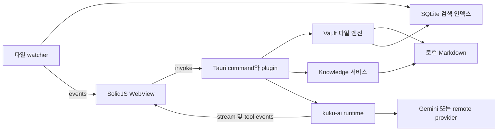

# Kuku의 Tauri 앱 구조와 ClineBrain 적용

Kuku의 데스크톱은 SolidJS 화면과 Rust 로컬 엔진이 IPC로 연결된 Tauri 2 앱이다. 파일·인덱스·AI·동기화를 Rust가 맡는 구조가 핵심이다. ClineBrain도 이 경계를 유지하되, 지식 관리에 필요하지 않은 회의 녹음과 캘린더 네이티브 의존성은 초기 범위에서 분리하는 것이 좋다.

기준 커밋: `c690bb6e952472c788acb7e3ae948c84b03f2268`. 소스와 설정에 대한 정적 분석이며 실행 성능, 설치 파일 크기, 배터리 사용량은 측정하지 않았다.

## 프로세스와 책임

Tauri는 시스템 WebView를 사용한다. Kuku는 Vite 개발 서버를 개발 중에 사용하고, 배포에서는 `dist`를 번들한다. `apps/web`의 Astro 서버가 데스크톱 UI를 제공하는 구조가 아니다. [Tauri 아키텍처](https://v2.tauri.app/concept/architecture/), [Kuku 설정](https://github.com/kuku-mom/kuku/blob/c690bb6e952472c788acb7e3ae948c84b03f2268/apps/desktop/src-tauri/tauri.conf.json)

| WebView 책임 | Rust 책임 |
| --- | --- |
| 탭, 에디터, 패널, 검색 UI | vault 경로와 파일 I/O |
| 제안 검토와 사용자 입력 | Knowledge 파싱·검증·적용·복구 |
| 명령 및 플러그인 UI 구성 | SQLite 인덱스와 파일 감시 |
| AI 메시지·diff·승인 UI | AI 세션, provider 통신, native tools |
| IPC 결과 표시 | Keychain, 암호화, OS API |

프런트엔드에서 버튼을 숨기는 것만으로 쓰기 권한을 제한하면 안 된다. Rust 명령 자체가 경로, revision, 허용 동작을 검증해야 한다.

## 앱 시작과 종료

`src-tauri/src/lib.rs`는 `VaultState`, `SearchState`, `SyncState`를 managed state로 등록한다. `kuku-ai`, deep-link, opener, dialog를 등록하고 데스크톱에서는 updater와 process 플러그인을 추가한다. setup에서는 variant 초기화, meeting notes 초기화, AI host 및 도구 등록, 인증 deep link handler 설정을 수행한다.

macOS 창 닫기는 앱 종료 대신 창을 숨긴다. 종료 이벤트는 회의 기능의 종료 처리 경로로 전달된다. 창 수명과 프로세스 수명이 다르므로 ClineBrain도 창을 닫았을 때 AI·index 작업을 계속할지, 종료할 때 미저장 문서를 어떻게 처리할지 명시해야 한다. [앱 진입점](https://github.com/kuku-mom/kuku/blob/c690bb6e952472c788acb7e3ae948c84b03f2268/apps/desktop/src-tauri/src/lib.rs)

## 두 종류의 플러그인

**프런트엔드 KukuPlugin**은 views, editor extension, commands, settings, services 등의 앱 확장 단위다. bootstrap은 등록 후 의존성을 위상 정렬하여 activate한다. Second Brain은 core-tool-registry, core-editor, core-indexer에 의존하는 내장 플러그인이다.

**Tauri plugin**은 Rust 명령과 상태를 WebView에 연결하는 경계다. `kuku-ai`는 `Builder::new("kuku-ai")`로 구현되며 명령 namespace는 `plugin:kuku-ai|...` 형태다. 두 플러그인 시스템을 같은 것으로 취급하면 서비스 의존성과 IPC 권한 설계가 섞인다. [프런트엔드 bootstrap](https://github.com/kuku-mom/kuku/blob/c690bb6e952472c788acb7e3ae948c84b03f2268/apps/desktop/src/plugins/bootstrap.ts), [Knowledge 플러그인](https://github.com/kuku-mom/kuku/blob/c690bb6e952472c788acb7e3ae948c84b03f2268/apps/desktop/src/plugins/builtin/knowledge/index.ts), [Rust AI 플러그인](https://github.com/kuku-mom/kuku/blob/c690bb6e952472c788acb7e3ae948c84b03f2268/crates/kuku-ai/src/lib.rs)

ClineBrain은 처음부터 외부 플러그인 마켓을 만들 필요는 없다. 코어 서비스 인터페이스와 내장 기능의 activate/dispose 수명만 먼저 분리하면 충분하다.

## IPC 경로

Knowledge의 기본 호출은 `service.ts → invoke(command, {request}) → #[command] → Knowledge Rust 함수`다. 결과는 `ok/value` 또는 `ok/error` 구조이며 도메인 오류와 transport 오류를 구분한다.

AI proxy 도구는 경로가 더 길다. Rust AI runtime에서 `ai:proxy-tool-call` 이벤트를 내보내고, 프런트엔드 registry handler가 해당 도구를 실행한다. Knowledge handler는 다시 Rust command를 호출하고, 결과를 `ai_submit_proxy_tool_result`로 AI runtime에 반환한다. 이 구조는 프런트엔드 플러그인의 도구 확장에 유리하지만 WebView의 활성 상태와 registration/disposal 순서에 영향을 받는다. [Knowledge service](https://github.com/kuku-mom/kuku/blob/c690bb6e952472c788acb7e3ae948c84b03f2268/apps/desktop/src/plugins/builtin/knowledge/service.ts), [proxy bridge](https://github.com/kuku-mom/kuku/blob/c690bb6e952472c788acb7e3ae948c84b03f2268/apps/desktop/src/plugins/builtin/ai_chat/proxy_tool_bridge.ts)

ClineBrain 제안: 핵심 Knowledge 도구는 Rust 서비스에 직접 연결하고, UI 기반 확장이 필요한 도구만 proxy로 제공한다. 모든 비동기 이벤트에는 session_id, request_id, vault_id를 넣어 오래된 vault나 취소된 요청의 결과가 화면에 섞이지 않게 한다. 이것은 Kuku의 현재 계약을 그대로 옮긴 것이 아니라 새 앱의 설계 제안이다.

## 파일 저장과 외부 편집

Vault를 열면 경로와 소유자를 확인하고 기존 watcher를 멈춘 뒤, 검색 runtime을 전환하고 sync 설정을 복원하며 새 watcher를 시작한다. 파일 접근은 vault-relative 경로를 사용하고 strict resolver는 경로 구성 요소의 symlink를 거부한다. [Vault open](https://github.com/kuku-mom/kuku/blob/c690bb6e952472c788acb7e3ae948c84b03f2268/apps/desktop/src-tauri/src/vault/commands.rs), [경로 검증](https://github.com/kuku-mom/kuku/blob/c690bb6e952472c788acb7e3ae948c84b03f2268/apps/desktop/src-tauri/src/vault/mod.rs)

일반 에디터 저장 흐름은 다음과 같다.

1. 디스크 내용을 읽고 BLAKE3 checksum을 계산한다.
2. 동일 내용이면 불필요한 쓰기를 생략한다.
3. 기대 checksum과 다르면 conflict를 반환한다.
4. 예상 파일 변경을 ledger에 기록한다.
5. `tokio::fs::write`로 저장하고 검색 인덱스에 알린다.

Knowledge Apply 문서는 SHA-256을 사용하므로 두 checksum 형식을 혼용하면 안 된다. 일반 저장은 read-check-write이고 temp-file rename 방식이 아니다. 따라서 체크 이후 외부 프로그램이 쓰는 경쟁 상태나 직접 쓰기 도중 중단에 대한 보장이 제한된다. checksum 검사는 충돌 감지 장치이지 원자적인 OS compare-and-swap이 아니다. [일반 저장](https://github.com/kuku-mom/kuku/blob/c690bb6e952472c788acb7e3ae948c84b03f2268/apps/desktop/src-tauri/src/vault/commands.rs), [BLAKE3 함수](https://github.com/kuku-mom/kuku/blob/c690bb6e952472c788acb7e3ae948c84b03f2268/apps/desktop/src-tauri/src/vault/checksum.rs)

watcher는 notify를 사용한다. 앱이 만든 변경을 `ExpectedMutationLedger`에 등록해 외부 변경과 구분한다. 현재 예상 이벤트 TTL은 2초이고 분리된 rename 이벤트 대기에는 600ms 상수가 있다. 파일 대량 변경과 rename 처리도 포함한다. 이 값들은 ClineBrain의 정답값이 아니라 원본 구현값이다. 실제 OS 이벤트 중복·지연·유실 조건에서 검증해야 한다. [watcher](https://github.com/kuku-mom/kuku/blob/c690bb6e952472c788acb7e3ae948c84b03f2268/apps/desktop/src-tauri/src/vault/watcher.rs)

ClineBrain에서는 파일별 쓰기 직렬화, 같은 디렉터리의 임시 파일, flush와 rename, 충돌 시 양쪽 버전 보존을 조합한다. 외부 에디터는 앱의 잠금을 준수하지 않으므로 atomic rename만으로 모든 동시 쓰기를 해결했다고 주장해서는 안 된다. 이벤트 유실에 대비한 재스캔과 revision 비교도 필요하다.

## 백그라운드 인덱스

SearchState는 vault별 DB 경로, writer job 채널, pending path, rebuild 상태를 관리한다. SQLite에는 WAL과 busy timeout이 설정되어 있다. Markdown 원본과 파생 인덱스가 분리되므로 인덱스를 재구성할 수 있다. [검색 runtime](https://github.com/kuku-mom/kuku/blob/c690bb6e952472c788acb7e3ae948c84b03f2268/apps/desktop/src-tauri/src/search/mod.rs), [DB 설정](https://github.com/kuku-mom/kuku/blob/c690bb6e952472c788acb7e3ae948c84b03f2268/apps/desktop/src-tauri/src/search/db.rs)

ClineBrain은 UI thread에서 대용량 문서 파싱을 하지 않고, writer queue에 상한과 배치 처리를 둔다. vault 전환 시 이전 작업을 취소하거나 generation ID로 결과를 폐기한다. 재색인 중에도 사용자 노트 열기와 저장이 막히지 않는지 측정한다.

## 권한과 보안 설정

현재 Kuku 설정에서 확인되는 사실은 다음과 같다.

| 설정 | 현재 값 또는 동작 | 새 앱에서의 판단 |
| --- | --- | --- |
| CSP | `null` | 그대로 복제하지 말고 렌더링에 맞는 CSP 구성 |
| capability 대상 | main window | 새 창은 필요한 권한만 별도 부여 |
| macOS App Sandbox | false | 직접 배포와 App Store 목표를 분리해서 설계 |
| Keychain | keyring apple-native | 키를 WebView 저장소에 평문 보관하지 않기 |
| debug secure storage | 명시적 환경변수로 파일 fallback 가능 | release에 포함되지 않는지 확인 |
| updater | 공개키와 HTTPS endpoint | 자체 서명키 및 배포 endpoint로 교체 |

Tauri capability는 IPC 접근 경계이고 macOS App Sandbox와 별개다. 또한 custom command의 경로·권한 검증을 capability가 대신해 주지 않는다. Markdown, Mermaid, 외부 링크와 렌더링 확장을 다루므로 CSP와 HTML 처리 정책을 실제 콘텐츠로 검증해야 한다. `csp: null` 하나만으로 악용 가능한 취약점이 입증된 것은 아니며 여기서는 재사용 시의 설계 항목으로 분류한다. [기본 capability](https://github.com/kuku-mom/kuku/blob/c690bb6e952472c788acb7e3ae948c84b03f2268/apps/desktop/src-tauri/capabilities/default.json), [entitlements](https://github.com/kuku-mom/kuku/blob/c690bb6e952472c788acb7e3ae948c84b03f2268/apps/desktop/src-tauri/entitlements.plist), [secure storage](https://github.com/kuku-mom/kuku/blob/c690bb6e952472c788acb7e3ae948c84b03f2268/apps/desktop/src-tauri/src/secure_storage.rs), [Tauri capabilities](https://v2.tauri.app/security/capabilities/)

## macOS 종속 부분

`build.rs`는 macOS에서 Objective-C++ 파일을 빌드한다. 오디오 캡처·회의 감지·EventKit 연동이며 AppKit, AVFoundation, CoreAudio, EventKit 등의 framework 및 ScreenCaptureKit weak linking을 사용한다. Python ASR worker와 관련 resource 파일도 번들 설정에 있다. 따라서 이 저장소는 TypeScript와 Rust만 복사하면 끝나는 최소 Tauri 앱이 아니다. [네이티브 빌드](https://github.com/kuku-mom/kuku/blob/c690bb6e952472c788acb7e3ae948c84b03f2268/apps/desktop/src-tauri/build.rs), [번들 resources](https://github.com/kuku-mom/kuku/blob/c690bb6e952472c788acb7e3ae948c84b03f2268/apps/desktop/src-tauri/tauri.conf.json)

설정의 minimumSystemVersion은 10.15지만 개별 녹음 기능까지 모두 그 OS에서 동작한다는 보장은 아니다. Windows/Linux도 Tauri가 지원한다는 사실과 Kuku의 모든 기능이 이식되었다는 사실을 구분해야 한다. ClineBrain의 초기 macOS 지식 앱에서는 native recording/calendar를 기능 flag 밖으로 분리하는 편이 빌드와 검증 범위를 줄인다.

## 빌드와 배포

설정상 앱 버전은 0.6.0, bundle target은 app/dmg, updater artifacts 생성이 활성화되어 있다. release 스크립트에는 DMG notarization과 stapling, updater용 signature 및 웹 release metadata를 다루는 흐름이 있다. 설정과 스크립트의 존재를 확인한 것이며 실제 배포 서명 성공을 검증한 것은 아니다. [release 스크립트](https://github.com/kuku-mom/kuku/blob/c690bb6e952472c788acb7e3ae948c84b03f2268/scripts/release.sh), [빌드 작업](https://github.com/kuku-mom/kuku/blob/c690bb6e952472c788acb7e3ae948c84b03f2268/apps/desktop/moon.yml)

dev/preview/prod는 variant 모듈에서 데이터 경로와 Keychain service 이름을 분리한다. 예를 들어 dev는 `~/.kuku.dev`다. 이 방식은 초기부터 가져올 가치가 있다. 개발 앱이 실제 사용자의 데이터나 인증 상태를 손상시키는 일을 줄인다. [variant](https://github.com/kuku-mom/kuku/blob/c690bb6e952472c788acb7e3ae948c84b03f2268/apps/desktop/src-tauri/src/variant.rs)

실행 명령의 기준은 저장소의 개발 문서와 moon task다. `pnpm --filter @kuku/desktop tauri:dev`가 데스크톱 개발 진입점이고, Rust/TS 테스트와 빌드가 구분되어 있다. native-smoke 기능은 release에서 compile error를 발생시켜 테스트용 제어 기능이 배포되는 것을 막는다. 브라우저에서 Vite 화면이 뜨는 것만으로 Tauri IPC·Keychain·watcher·설치 파일 검증이 끝난 것은 아니다.

## 동기화의 위치

동기화는 Rust 클라이언트의 scanner, packer, planner, applier, transfer, merge, keys, crypto 등의 모듈과 Go 서버로 나뉜다. crypto에는 XChaCha20-Poly1305, Ed25519, AAD 및 ciphertext hash 구조가 있다. 이는 로컬 지식 엔진 위에 얹는 별도 계층이다. [동기화 crypto](https://github.com/kuku-mom/kuku/blob/c690bb6e952472c788acb7e3ae948c84b03f2268/apps/desktop/src-tauri/src/sync/crypto.rs)

암호화 동기화가 AI 요청 내용까지 암호화된 채 모델에서 처리된다는 뜻은 아니다. provider에 보낼 context의 범위는 별도로 설계해야 한다. ClineBrain은 로컬 저장·충돌 처리·복구를 먼저 검증한 후 동기화를 추가해야 디스크 충돌과 원격 충돌을 구분할 수 있다.
